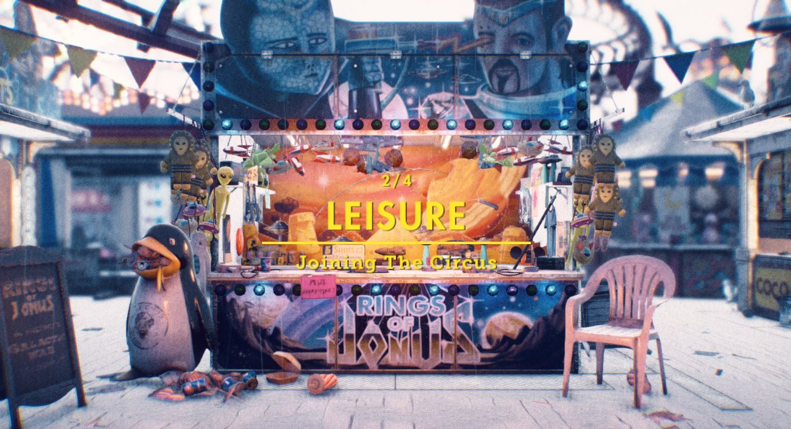
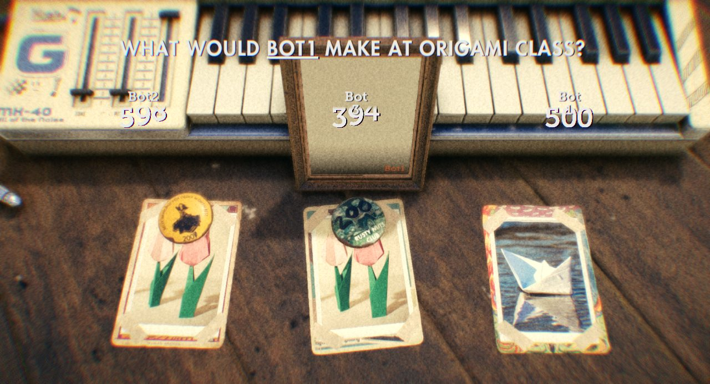
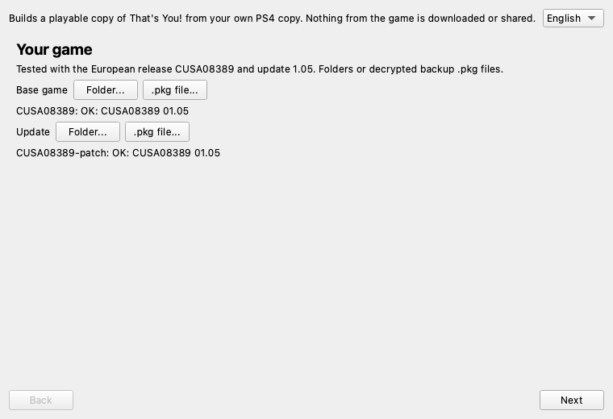

<h1 align="center">That's You! on Mac and PC</h1>

  <b>Play the PS4 party game "That's You!" on a Mac or PC, with your phones as controllers again.</b> 
  No app to install: every phone just opens a web page. Free and open source. Bring your own copy of the game.

  <a href="#how-to-play">How to play</a>
  &nbsp;·&nbsp;
  <a href="#getting-started">Getting started</a>
  &nbsp;·&nbsp;
  <a href="#what-you-need">What you need</a>
  &nbsp;·&nbsp;
  <a href="#questions">Questions</a>
  &nbsp;·&nbsp;
  <a href="#česky">Česky</a>

  
   Scan the code in the corner and you are in.

> [!IMPORTANT]
> The game is not included. You need your own PS4 copy of That's You! (a backup of the game and its
> update). The scripts here turn it into a game that runs on your computer.

## What it is

That's You! (2017) is a PlayLink party game for 2 to 6 players: everybody answers questions about each other on their phone, draws, takes silly photos and finds out what the others really think. It needed the "That's You!" phone app, which has disappeared from the app stores, so the game could no longer be played.

This project brings it back:

- **The whole game runs natively** on Macs with Apple silicon, and on Windows PCs (experimental).
- **Phones need nothing installed.** Scan the QR code on the screen and the controller opens in the phone's browser, on iPhone and Android alike. It looks and works like the original app, with the original art.
- **Live camera effects** for selfies and photo rounds, as in the app.
- **Plays on your home network.** The phones talk straight to the computer; nothing goes through the internet during a game.
- **All locations, game modes and languages** of the PS4 version, voices and music included.

| Who's the circus act? | The fairground |
| --- | --- |
|  |  |
| **Draw on your friends' photos** | **Guess what they would make** |
|  |  |

On the phones:

  

## How to play

1. Start the game on the computer that is connected to your TV (or just play on its screen), pick a language and wait for the main menu.
2. Everybody scans the QR code in the top right corner with their phone camera, taps **PLAY** and allows the camera.
3. Enter your name, take a selfie, and one player holds **START**. Then follow the TV.

The phones must be on the same Wi-Fi as the computer. The page keeps the phone screen on while you play, and a phone that drops out for a moment rejoins by itself.

The menus on the computer are controlled with the keyboard. The on-screen hints show the keys:

| Key | Does |
| --- | --- |
| Arrow keys | Move around the menus |
| Enter | Select (the PS4 Cross button) |
| Esc | Back (Circle) |
| H, P, K, L, Tab | Help, Play Online, the side buttons and Settings, as shown on screen |
| J | Hide or show the QR code |

## Getting started

You build the game yourself from your own copy, with a small builder app. You choose your files, and the computer does the rest in about an hour.

  

1. **Get your game files.** A backup of your PS4 copy of That's You! and its update, as folders or as decrypted backup `.pkg` files. Tested with the European release CUSA08389 and update 1.05; other regions may work but are untested.
2. **Get the phone app.** The Android app's APK file, version 1.6 (`com.playstation.iwyk`). The phones take their look and translations from it; the builder's **Find it** button helps you search. If you really cannot get it, the builder can continue without it, but then the phones show a plain English-only page without the original art, and that mode is not really tested.
3. **Install Unity Hub** from [unity.com/download](https://unity.com/download) and sign in to it with a free Unity account. The builder installs the right Unity version by itself.
4. **Download the builder** from the [latest release](../../releases/latest): `ThatsYou-Builder-macOS.dmg` for a Mac, `ThatsYou-Builder-Windows.exe` for a PC.
   - Mac: open the DMG, drag the builder to Applications, then right-click it and choose **Open** the first time (it is not notarized).
   - Windows: if SmartScreen warns you, choose **More info** and then **Run anyway**.
5. **Run it.** Choose your game, its update and the APK, pick how the phone page gets online, and press **Build the game**. You can close the builder at any time; it continues where it stopped.
6. **Play.** Open the game from the folder you chose.

**The phone page** is the web page the phones play on. The builder offers two ways to put it online:

- **The free Cloudflare tunnel** (the default): nothing to set up. Each time the game starts, it puts the page online by itself, so the computer needs internet then. The QR code appears a few seconds after the main menu.
- **Your own Cloudflare account**: the page gets a fixed address on your free account. You only sign in once in your browser; the builder does everything else.

Building from the command line, without the app, is described in [docs/DEVELOPERS.md](docs/DEVELOPERS.md).

## What you need

| | |
| --- | --- |
| To build | A Mac with Apple silicon (M1 or later), or a Windows 10/11 PC (experimental). Each builds the game for itself. |
| Software | Unity Hub with a free Unity account. Everything else is downloaded by the builder. |
| Disk space | About 60 GB while building, about 7 GB for the finished game |
| To play | A Mac with Apple silicon, or a Windows 10/11 PC (experimental) |
| Phones | Any recent iPhone or Android phone with a camera: Safari 16.4+ or Chrome |
| Network | Phones and computer on the same Wi-Fi, and internet when the game starts (for the free tunnel) |

## Questions

**Is the game included?** No. Nothing from the game or the app is in this repository. The scripts read your own copies on your own computer.

**Does it work on Windows?** It builds and starts, and phones can join, but it has not been tested on a real gaming PC yet. Treat it as experimental and tell us how it goes.

**Can I use a game controller?** The PS4 controller mapping for PC pads is experimental and untested. The keyboard always works.

**Do the phones need internet?** To open the page, yes. During the game they talk directly to the computer over your Wi-Fi.

**A phone says "Could not join because the game has already started".** Players can only join before the game starts. Finish or quit the game, and everybody joins from the main menu.

**Can I copy the finished game to another computer?** Yes, for yourself. Copy the whole build folder. Please do not upload it anywhere: it contains the original game.

## Česky

That's You! je party hra pro PS4, ve které se 2 až 6 hráčů na mobilech ptá jeden na druhého, kreslí a fotí. Původní aplikace pro telefony zmizela z obchodů, takže hra přestala jít hrát. Tento projekt ji vrací: hra běží přímo na Macu s Apple silicon (a zkušebně na Windows) a telefony nepotřebují žádnou aplikaci. Stačí naskenovat QR kód na obrazovce a ovladač se otevře v prohlížeči, na iPhonu i Androidu, včetně živých efektů kamery. Hra sama v repozitáři není: skripty ji sestaví z tvé vlastní zálohy PS4 hry. Hru sestavíš aplikací ze stránky [Releases](../../releases/latest); postup je v části [Getting started](#getting-started).

## For developers

How the build works, all options, tests and the layout of the code: [docs/DEVELOPERS.md](docs/DEVELOPERS.md).

## Legal

This project is not affiliated with or endorsed by Sony Interactive Entertainment or Supermassive Games. "That's You!" and PlayLink are their trademarks. The screenshots show the game running with this project. Use it only with copies of the game and app that you own.

The code in this repository is released under the [MIT licence](LICENSE). It covers only the scripts and the port's own code, not the game.
