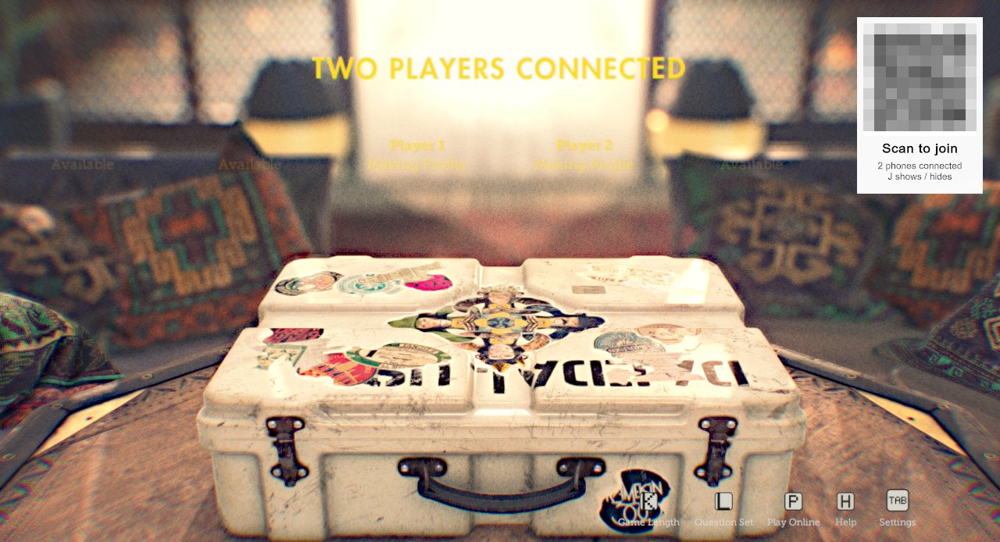
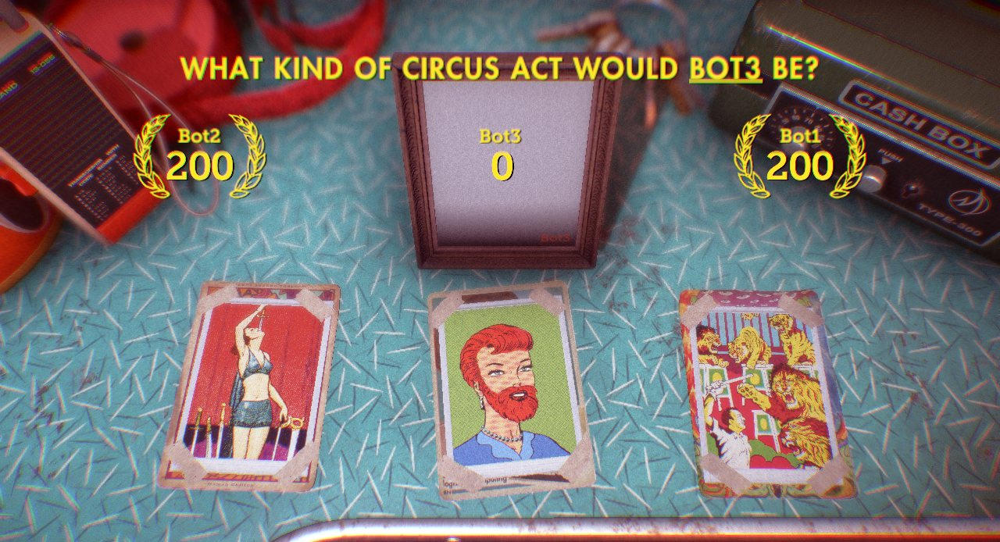
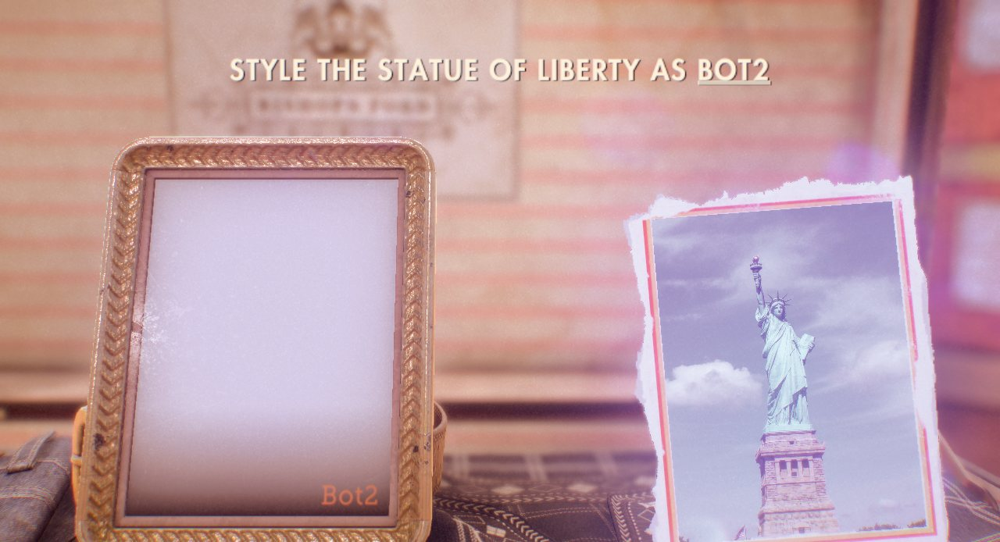
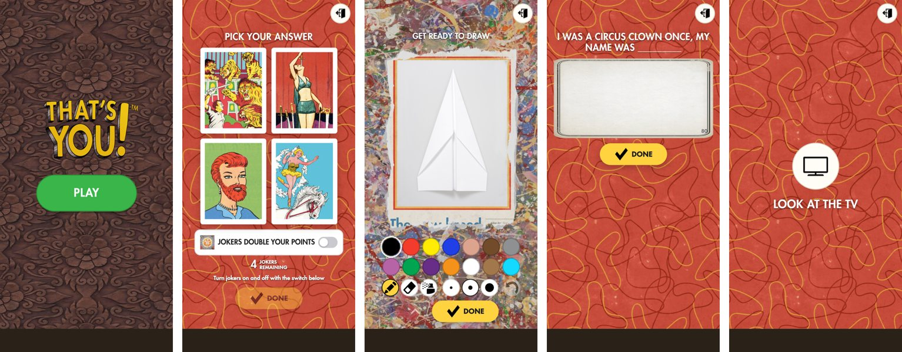

<h1 align="center">That's You! on Mac and PC</h1>

<p align="center">
  <b>Play the PS4 party game "That's You!" on a Mac or PC, with your phones as controllers again.</b><br>
  No app to install: every phone just opens a web page. Free and open source. Bring your own copy of the game.
</p>

<p align="center">
  <a href="#how-to-play">How to play</a>
  &nbsp;·&nbsp;
  <a href="#getting-started">Getting started</a>
  &nbsp;·&nbsp;
  <a href="#what-you-need">What you need</a>
  &nbsp;·&nbsp;
  <a href="#questions">Questions</a>
  &nbsp;·&nbsp;
  <a href="#česky">Česky</a>
</p>

<p align="center">
  
  <br><sub>Scan the code in the corner and you are in.</sub>
</p>

> [!IMPORTANT]
> The game is not included. You need your own PS4 copy of That's You! (a backup of the game and its
> update). The scripts here turn it into a game that runs on your computer.

## What it is

That's You! (2017) is a PlayLink party game for 2 to 6 players: everybody answers questions about each other on their phone, draws, takes silly photos and finds out what the others really think. It needed the "That's You!" phone app, which has disappeared from the app stores, so the game could no longer be played.

This project brings it back:

- **The whole game runs natively** on Macs with Apple silicon, and on Windows PCs (experimental).
- **Phones need nothing installed.** Scan the QR code on the screen and the controller opens in the phone's browser, on iPhone and Android alike. It looks and works like the original app, with the original art.
- **Live camera effects** for selfies and photo rounds, as in the app.
- **Plays on your home network.** The phones talk straight to the computer; nothing goes through the internet during a game.
- **All locations, game modes and languages** of the PS4 version, voices and music included.

| Who's the circus act? | The fairground |
| --- | --- |
|  |  |
| **Draw on your friends' photos** | **Guess what they would make** |
|  |  |

On the phones:

<p align="center">
  
</p>

## How to play

1. Start the game on the computer that is connected to your TV (or just play on its screen), pick a language and wait for the main menu.
2. Everybody scans the QR code in the top right corner with their phone camera, taps **PLAY** and allows the camera.
3. Enter your name, take a selfie, and one player holds **START**. Then follow the TV.

The phones must be on the same Wi-Fi as the computer. The page keeps the phone screen on while you play, and a phone that drops out for a moment rejoins by itself.

The menus on the computer are controlled with the keyboard. The on-screen hints show the keys:

| Key | Does |
| --- | --- |
| Arrow keys | Move around the menus |
| Enter | Select (the PS4 Cross button) |
| Esc | Back (Circle) |
| H, P, K, L, Tab | Help, Play Online, the side buttons and Settings, as shown on screen |
| J | Hide or show the QR code |

## Getting started

There is no ready-made download yet: you build the game yourself from your copy, with the scripts in this repository. It takes some setup, and then about an hour of the computer working on its own.

1. **Get your game files.** Make a backup of your PS4 copy of That's You! (CUSA08389) together with its update, as decrypted folders. For the phone page's original look, also get the Android app's APK file (`com.playstation.iwyk`).
2. **Install the tools** listed in [What you need](#what-you-need).
3. **Tell the scripts where everything is.** Copy `config/local.example.json` to `config/local.json` and fill in the paths.
4. **Put the phone page online.** The phone controller is a small web page that has to be reachable over HTTPS, for example on a free Cloudflare account. The scripts upload it for you.
5. **Build:**

   ```sh
   python3 -m pipeline.build_all        # unpacks your game into a Unity project (about an hour)
   python3 -m pipeline.build_native     # network library
   python3 -m pipeline.build_player     # the game: work/builds/mac/ThatsYou.app
   python3 -m pipeline.deploy_web --build   # the phone page
   ```

6. **Play.** Open `work/builds/mac/ThatsYou.app`. For Windows, add `python3 -m pipeline.build_player --target win` and copy the `work/builds/win` folder to the PC.

The details of every step are in [docs/DEVELOPERS.md](docs/DEVELOPERS.md).

## What you need

| | |
| --- | --- |
| To build | A Mac with Apple silicon (M1 or later). It builds the Windows version too. |
| Tools | Unity 6000.6.10f1 (free, via Unity Hub), Python 3.11+, Go, cmake, .NET runtime, Node.js |
| Disk space | About 60 GB while building, about 7 GB for the finished game |
| To play | A Mac with Apple silicon, or a Windows 10/11 PC (experimental) |
| Phones | Any recent iPhone or Android phone with a camera: Safari 16.4+ or Chrome |
| Network | Phones and computer on the same Wi-Fi |

## Questions

**Is the game included?** No. Nothing from the game or the app is in this repository. The scripts read your own copies on your own computer.

**Does it work on Windows?** It builds and starts, and phones can join, but it has not been tested on a real gaming PC yet. Treat it as experimental and tell us how it goes.

**Can I use a game controller?** The PS4 controller mapping for PC pads is experimental and untested. The keyboard always works.

**Do the phones need internet?** Only to open the page the first time. During the game they talk directly to the computer over your Wi-Fi.

**A phone says "Could not join because the game has already started".** Players can only join before the game starts. Finish or quit the game, and everybody joins from the main menu.

**Can I copy the finished game to another computer?** Yes, for yourself. Copy the whole build folder. Please do not upload it anywhere: it contains the original game.

## Česky

That's You! je party hra pro PS4, ve které se 2 až 6 hráčů na mobilech ptá jeden na druhého, kreslí a fotí. Původní aplikace pro telefony zmizela z obchodů, takže hra přestala jít hrát. Tento projekt ji vrací: hra běží přímo na Macu s Apple silicon (a zkušebně na Windows) a telefony nepotřebují žádnou aplikaci. Stačí naskenovat QR kód na obrazovce a ovladač se otevře v prohlížeči, na iPhonu i Androidu, včetně živých efektů kamery. Hra sama v repozitáři není: skripty ji sestaví z tvé vlastní zálohy PS4 hry. Postup je v části [Getting started](#getting-started).

## For developers

How the build works, all options, tests and the layout of the code: [docs/DEVELOPERS.md](docs/DEVELOPERS.md).

## Legal

This project is not affiliated with or endorsed by Sony Interactive Entertainment or Supermassive Games. "That's You!" and PlayLink are their trademarks. The screenshots show the game running with this project. Use it only with copies of the game and app that you own.

The code in this repository is released under the [MIT licence](LICENSE). It covers only the scripts and the port's own code, not the game.
